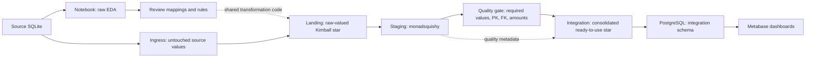

# OmniCorp: raw EDA, Landing star, Staging, Integration, Metabase

V2 is a self-contained single-host deployment. Copy the entire
`omnicorp_data_stack_v2/` folder to another machine. All pipeline code and runtime
configuration live inside this folder.

## Data contract



1. **Notebook EDA comes first during development.** Each notebook reads the raw
   source tables relevant to its model. It can use existing SQLite files or
   download the public sample databases. No published pipeline snapshot is needed.
   Notebook cells then preview Landing, Staging and Integration with the same
   Python functions used by production. EDA is a human review step, not a notebook
   execution requirement on every scheduled run.
2. **Ingress preserves source values.** Column headers are normalized for the flow;
   source database table names are retained in ingress paths. Exact raw headers
   are available to the EDA reader. The raw layer remains available for diagnosis.
3. **Landing already has the Kimball star structure.** It maps columns, builds
   source-qualified technical keys, joins actual dimension IDs into the fact, and
   derives the line amount from source measures. Source text, date strings and
   source ID values remain uncleaned. Calendar attributes remain empty here.
   `source_customer_id`, `source_employee_id`, and `source_product_id` retain the
   original natural keys on each fact line. The fact grain is one order line.
   Chinook employee attribution comes from the customer's `SupportRepId`.
4. **Staging applies monadsquishy.** Text normalization, contact checks, numeric
   rules and date parsing happen here. The date dimension derives calendar
   attributes only after parsing, and equivalent raw dates conform to one day.
   Fact `date_id` references `dim_date.date_id` and must equal the parsed
   `order_date`. Customer, employee, product and location references are checked.
   A missing source employee reference is distinguished from a genuinely blank
   employee ID. Failed fact rows are retained for investigation and block release.
5. **Integration is the serving model.** It consolidates both sources into exactly
   six query-ready tables, validates the combined model, and preserves quality
   metadata in Parquet footers. New runs do not require a separate Data Mart zone.
6. **Metabase is the dashboard application.** A transactionally refreshed PostgreSQL
   `integration` schema serves the six tables with real PK/FK constraints. Metabase
   connects using `metabase_reader`, which has SELECT privileges. Its application
   database is the separate `metabase` database using `metabase_app`.

The six tables are `dim_date`, `dim_location`, `dim_customer`, `dim_employee`,
`dim_product`, and `fact_order`. Keys are stable source-qualified identifiers;
this is a Type 1 star, not an SCD Type 2 implementation. The location and date
keys are shared dimensions. Quality metadata is a sidecar to processing; it is
not the Metabase application and is not a substitute for the business tables.

## Layout and ownership

```text
omnicorp_data_stack_v2/
├── flow/
│   ├── flow_main.py
│   ├── flow_dim_customer.py
│   ├── flow_dim_employee.py
│   ├── flow_dim_product.py
│   ├── flow_dim_location.py
│   ├── flow_dim_date.py
│   └── flow_fact_order.py
├── notebook/                 # six raw EDA and layer-preview notebooks
├── monadsquishy/             # reusable engine and validators
├── utils/
│   ├── modeling.py           # Landing dimension joins
│   ├── quality.py            # shared Staging rules and integrity checks
│   ├── integration.py        # consolidation shared with notebook previews
│   ├── eda.py                # raw reader and read-only previews
│   ├── serving.py            # PostgreSQL bootstrap and atomic refresh
│   ├── runtime.py            # lake publication, recovery and health
│   └── config.py, schema.py, storage.py, ingestion.py, provision_secrets.py
├── tests/
├── run_pipeline.py           # supported Python CLI
├── ELT_V2.sh                 # portable Docker launcher
├── docker-compose.prod.yml   # services and persistent volumes
└── Dockerfile                # locked runtime dependencies
```

Each table module owns its source mappings and a `stage_dataframe` function.
Its Prefect staging flow delegates to that same function. Notebook previews call
it directly. Change table mappings in `flow/flow_<table>.py` and shared rules in
`utils/quality.py`. Do not copy production transformations into notebook cells.
The staging coordinator invokes six named flows for each source, then evaluates
model relationships across the whole source before writing quality metadata.

## EDA and local execution

Use Python 3.13 and an isolated environment:

```sh
cd omnicorp_data_stack_v2
python3.13 -m venv .venv
. .venv/bin/activate
pip install --require-hashes -r requirements.lock
pip check
python -m unittest discover -s tests -v
```

Open `notebook/<table>.ipynb` with a kernel using these project dependencies.
Start Jupyter from the project directory or `notebook/`, using your team's Jupyter
or VS Code installation. In the notebook, set `RAW_DB_PATHS` to local SQLite paths;
leave it empty to use public sample downloads. `SOURCE_SYSTEMS` chooses the sources.
The notebook shows raw profiles before transformations, the Landing keys and raw
values, Staging results and quality logs, then a consolidated Integration preview.
It does not write zones, publish a snapshot, or update PostgreSQL.

After EDA and review, execute the production transformations locally:

```sh
python run_pipeline.py run
python run_pipeline.py status
```

`SERVING_ENABLED` defaults to false for local runs. The production Compose runner
sets it to true and refreshes PostgreSQL after the lake publication succeeds.
Notebooks are excluded from the production image. Clear outputs containing
personal data or credentials before committing them.

## Snapshot publication and compatibility

Each run owns `obs_data/runs/<run_id>/` with ingress, landing, staging and integration
zones. `latest.json` points only to a complete six-table snapshot. Readers resolve
it once, then use the artifact paths in that run's `manifest.json`. New version 2
manifests declare `published_zone: integration`, artifact hashes, row counts,
quality policy and runtime versions. Never glob across runs or read partial runs.

The default quality gate tolerates zero failed rule checks. An explicit
`MAX_FAILED_RULE_CHECKS` exception can permit field-rule failures, but never a
broken relationship, invalid fact, duplicate key, date mismatch or amount mismatch.
Downloads have connect/read timeouts, a 256 MiB limit and SQLite validation.
`CHINOOK_SHA256` and `NORTHWIND_SHA256` optionally pin approved upstream content.
Upstream branch URLs are mutable; approve source changes through review.

Atomic Parquet writes and a writer lock protect local publication. This is a local
filesystem, single-writer design, not distributed locking or HA storage. Failed
runs and their raw/intermediate data remain available; a data-quality failure
leaves the previous lake pointer intact. No retention deletion is automatic.

Existing version 1 snapshots and their Data Mart artifacts are not rewritten.
Backup, restore, rollback and the legacy published-table reader still accept them.
Metabase serving requires a new version 2 Integration snapshot; rerun ingestion
instead of silently converting old files. The unused Data Mart exporter has been
removed; existing snapshot reading and recovery remain supported.

## Run on another machine

Copy this entire folder, including `.env.example`, `.dockerignore` and `.gitignore`. Do not
share existing `.env`, `.secrets/`, `obs_data/`, backups or a local `.venv/`.
Keep `flow/`, `utils/`, `monadsquishy/`, the Docker files, entry points, health
probe and `requirements.lock` together. Notebooks are for EDA; tests and
`requirements.in` support validation and dependency maintenance.

Install Docker with Compose v2 supporting `up --wait --wait-timeout`, and Python 3
for standard-library credential generation. Python package installation on the
host is not required for the Docker launcher. Start Docker first. The initial
build and source downloads need internet access.

```sh
# From the repository root; absolute paths work from any directory too.
bash omnicorp_data_stack_v2/ELT_V2.sh

# For subsequent runs against services already started:
bash omnicorp_data_stack_v2/ELT_V2.sh run
bash omnicorp_data_stack_v2/ELT_V2.sh status --max-age-hours 26
bash omnicorp_data_stack_v2/ELT_V2.sh logs prefect
bash omnicorp_data_stack_v2/ELT_V2.sh stop
```

The default command (`start`) creates `.env` only if missing, provisions missing
secrets, builds the locked image, waits for Prefect and PostgreSQL, initializes
the warehouse roles, waits for Metabase and runs the pipeline. It stops immediately
if any step fails. Repeated starts preserve configuration, credentials and data.
`stop` retains every named volume. It does not delete snapshots or dashboards.
To customize settings before the first start, copy `.env.example` to `.env` and
edit it. Do not change existing database credentials without a coordinated
credential rotation.

`bash ELT_V2.sh help` shows commands without Docker. `bash ELT_V2.sh check`
validates Compose without creating files or requiring a running Docker daemon.
Both commands work when invoked using the script's full path.

The equivalent manual Docker commands use `docker-compose.prod.yml` and the
Python CLI `run_pipeline.py`. The Bash launcher never regenerates project code.

The secret provisioner creates missing credentials and never overwrites existing
files. It creates independent warehouse administrator, writer, reader and Metabase
application credentials, plus encryption and session keys. The host secret
parent directory is private; file mounts are readable by the non-root containers.
Use your secret manager instead of local generation on a managed deployment.
Do not regenerate Metabase's encryption key when restoring its application DB.

Prefect is on `http://localhost:4206`; Metabase is on `http://localhost:3051`.
Ports bind only to host loopback; PostgreSQL has no published host port. Provide
an approved TLS reverse proxy or SSH tunnel for remote access. The application
containers use non-root users, resource limits and protected filesystems. Persist
`lake_data`, `prefect_data`, and `bi_postgres_data`. Scan the built images and pin
approved image digests before production promotion.

Complete Metabase's first-user setup at `http://localhost:3051`. Add a PostgreSQL
connection to host `warehouse`, port `5432`, database `omnicorp`, schema
`integration`, user `metabase_reader`, using the password from `.secrets/bi_reader`.
Create questions and dashboards in Metabase using the Integration tables.
Metabase's application DB stores its users, questions and dashboards; it is not
the `omnicorp` warehouse. Encryption/session settings follow the
[official Metabase security guidance](https://www.metabase.com/docs/latest/installation-and-operation/security-best-practices-self-hosting).

The lake pointer and PostgreSQL are separate transactional resources. PostgreSQL
refresh uses one transaction for all six stable tables, quality summaries and the
active run record. Reads retain the previous committed version if COPY or a
constraint fails. Repeating a successful snapshot is idempotent. Existing serving
schema drift fails rather than causing an implicit database migration.

If the PostgreSQL refresh fails after lake publication, the lake snapshot stays
complete and Metabase retains its previous committed data. The job exits nonzero,
structured logs record the failure, and the status command detects missing or
out-of-sync serving data. Retry
without downloading again:

```sh
docker compose -f docker-compose.prod.yml --profile jobs run --rm --no-deps runner \
  python -m utils.serving publish
```

`serving.json` records the successfully loaded run. It must match `latest.json`
when serving is enabled. Metabase can display `integration._pipeline_run` to show
which snapshot its queries are using. Counts of quality checks are available in
`integration.quality_summary`; failed raw samples remain in protected Parquet
metadata and are not copied into the dashboard summary table.

## Status and recovery

There is no Prometheus exporter, monitoring service or alert configuration in
this deployment. Pipeline failures still exit nonzero and produce structured
logs. Check snapshot completeness, artifact sizes, freshness and the serving
run marker with the pipeline CLI (the default freshness limit is 26 hours):

```sh
docker compose -f docker-compose.prod.yml --profile jobs run --rm --no-deps runner \
  python run_pipeline.py status --max-age-hours 26
```

Container health checks remain in place because Prefect, PostgreSQL and Metabase
must be ready before dependent services start.

The pipeline runs on demand with `bash ELT_V2.sh run`. This repository
does not provide a host scheduler template. Monitor storage capacity; old and
failed runs are not deleted automatically.

Rollback, then synchronize Metabase with that selected version 2 snapshot:

```sh
docker compose -f docker-compose.prod.yml --profile jobs run --rm --no-deps runner \
  python run_pipeline.py rollback --run-id RUN_ID
docker compose -f docker-compose.prod.yml --profile jobs run --rm --no-deps runner \
  python -m utils.serving publish
```

After provisioning a host backup directory writable by container UID 10001:

```sh
docker compose -f docker-compose.prod.yml --profile jobs run --rm --no-deps \
  -v "$PWD/backups:/backup" runner \
  python run_pipeline.py backup --destination /backup/snapshot-2026-10-17

docker compose -f docker-compose.prod.yml --profile jobs run --rm --no-deps \
  -v "$PWD/backups:/backup:ro" runner \
  python run_pipeline.py restore --backup /backup/snapshot-2026-10-17

docker compose -f docker-compose.prod.yml --profile jobs run --rm --no-deps runner \
  python -m utils.serving publish
```

The destination must not already exist. Backups include the entire chosen run and
are verified by hashes. Copy backups to encrypted off-host storage. Separately
back up PostgreSQL's `metabase` application DB, the role configuration, Prefect's
consistent database, and secrets/encryption keys. Warehouse business tables can
be rebuilt from a completed Integration snapshot; saved dashboards cannot be
recovered from a lake backup alone. Test restoration onto an empty environment.
Rollback freshness uses the original snapshot completion time.

## Verification and changes

Default tests use synthetic raw data and execute all notebook code cells without
network access. Opt-in Prefect tests require `RUN_PREFECT_INTEGRATION=1` and an
isolated authenticated API. PostgreSQL tests require `RUN_POSTGRES_INTEGRATION=1`
and a disposable administrator-controlled server; they test PK/FK creation,
read-only access, idempotency and transaction rollback. Do not point those tests
at a production database.

CI audits the hashed lock, runs default tests, tests PostgreSQL on an isolated
service, builds the non-root image, starts authenticated Prefect and Metabase,
and exercises the Prefect flow. Run the checks in your target environment
before deployment; a valid Compose configuration does not prove service startup.

Direct dependencies are in `requirements.in`. Resolve with Python 3.13 using
`uv pip compile requirements.in --python-version 3.13 --universal --generate-hashes -o requirements.lock`,
then audit and run the affected suites before promotion. Back up Prefect's and
Metabase's application databases before upgrading their versions. Data snapshot
rollback does not reverse application database migrations.
